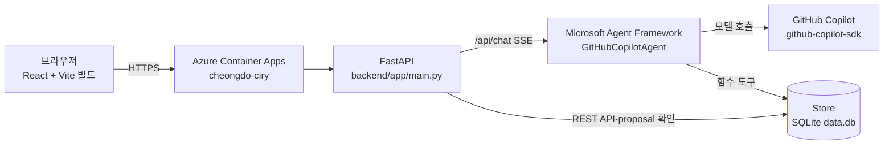

# TRD — 구현 기준 기술 문서

- 기준: 2026-11-05, `main` 워킹트리. 이 문서는 저장소 코드와 실제 실행·조회 결과만 적는다. 범위(무엇을 만들지)는 [PRD](PRD.md)를 따른다.
- 근거 표기: 코드 경로, 또는 `az containerapp show` 등 조회 결과.

## 1. 아키텍처



| 구성 | 실제 값 | 근거 |
|---|---|---|
| 컨테이너 | 단일 이미지. 1단계 `node:20-slim`에서 `npm run build`, 2단계 `python:3.11-slim`에서 uvicorn 실행. Vite 빌드 결과를 `/app/static`에 복사하고 FastAPI `StaticFiles`가 `/`로 서빙 | `Dockerfile`, `backend/app/main.py` 끝부분 |
| 실행 환경 | Azure Container Apps, 환경 `cheongdo-ciry-env`, workload profile `Consumption` | `az containerapp env list` |
| 스케일 | minReplicas 1, maxReplicas 2, 별도 scale rule 없음 | `az containerapp show` (`properties.template.scale`) |
| Ingress | external, targetPort 8000 | `az containerapp show` |
| 이미지 저장소 | ACR `ca827d321e2cacr`, 리포지토리 `cheongdo-ciry` | `az acr repository list` |
| 로그 | 환경의 `appLogsConfiguration.destination` = `log-analytics` | `az containerapp env list` |
| Copilot 토큰 | Container Apps secret `copilot-token`을 env `COPILOT_GITHUB_TOKEN`에 `secretRef`로 연결 | `az containerapp show` (env, secret 이름만 조회) |
| 접근 | `DEMO_PASSWORD` env가 설정돼 있지 않아 Basic 인증 미들웨어가 동작하지 않음(로그인 없이 데모 접근) | `main.py` `demo_auth`, `az containerapp show` env 목록 |

## 2. 에이전트

### 패키지

`requirements.txt`가 직접 고정한 것은 `agent-framework-github-copilot==2.1.1`, `fastapi==0.115.6`, `uvicorn[standard]==0.34.0`, `pydantic>=2.7`이다.
로컬 `.venv`에 설치된 전이 의존성은 `agent-framework-core 1.24.0`, `github-copilot-sdk 1.0.28`이다(`pip list` 결과, `requirements.txt`에 고정돼 있지 않음).

### 구성

- `backend/app/chat.py`의 `get_agent()`가 `agent_framework.github.GitHubCopilotAgent`를 한 번 만들어 재사용한다.
  - `instructions=SYSTEM_INSTRUCTIONS`, `tools=make_tools()`.
  - 모델 `GITHUB_COPILOT_MODEL`(기본 `gpt-5`), 타임아웃 `GITHUB_COPILOT_TIMEOUT`(기본 60초).
  - `on_permission_request=PermissionHandler.approve_all`. 이 설정은 SDK 권한 프롬프트만 자동 승인한다. 쓰기 승인은 3절의 서버 proposal 확인으로 처리한다.
- 읽기 도구 6개(`list_due_bills`, `get_bill`, `get_rent`, `get_rent_transfer_text`, `list_reminders`, `get_payment_guide`)는 앱 MCP 서버(`backend/mcp_server.py`, stdio, 외부 HTTP 미노출)로 연결한다. Copilot SDK `mcp_servers` 옵션으로 CLI가 서버를 직접 띄우며 같은 `DB_PATH` SQLite를 읽는다. 시작 시 연결 확인에 실패하면 기존 읽기 함수 도구로 대체하고 `/health`의 `mcp`에 `connected`/`fallback`을 표시한다. 쓰기는 함수 도구 proposal → confirm 흐름 그대로다. 실제 Copilot 모델이 MCP 도구를 호출하는 것은 토큰이 없어 확인하지 못했다.

### 등록된 도구 (`make_tools()`)

| 도구 | 역할 | 읽기/쓰기 |
|---|---|---|
| `list_bills(kind=None)` | 저장된 청구 목록 조회, `kind`로 필터 | 읽기 |
| `get_bill(bill_id)` | ID로 청구 1건 조회, 없으면 null | 읽기 |
| `refresh_electricity()` | `SampleKepcoAdapter`의 합성 전기 청구(`source=sample`)를 가져와 저장 | **쓰기(직접)**: proposal 없이 샘플 청구를 DB에 upsert |
| `get_rent()` | 월세 설정 조회 | 읽기 |
| `save_rent(payload)` | `RentConfig` 검증, 누락 필드 계산 후 **저장 제안만** 반환 | 쓰기 제안(proposal) |
| `rent_transfer_text()` | 저장된 월세로 송금 안내 텍스트 생성 | 읽기 |
| `reminders(bill_id=None)` | 알림 예약 목록 조회 | 읽기 |
| `confirm_paid(bill_id)` | 납부 확인 **제안만** 반환 | 쓰기 제안(proposal) |
| `set_reminder_enabled(enabled, bill_id=None)` | 알림 켜기/끄기 **제안만** 반환 | 쓰기 제안(proposal) |

모델을 거치지 않는 결정적 경로(`_deterministic_chat`)도 있다. 순서대로 검사한다.

1. 고지서 붙여넣기(`청구금액`/`납부기한`/`고지서` 등 키워드와 금액·청구월 정규식) → `save_bill` proposal. 이벤트 이름은 `extract_bill`이고 원문 인자는 `[redacted]`로 기록한다.
2. "월세" + 등록/설정/저장/입력 → `save_rent` 도구로 proposal 생성.
3. "confirm_paid" 또는 "납부 확인" + `bill_id=...` → `get_bill`로 존재 확인 후 `confirm_paid` proposal. 없는 청구면 proposal 없이 안내만 한다.
4. "알림" + `enabled=true|false` 또는 켜/꺼·끄·해제·중지 → `set_reminder_enabled` proposal.
5. "전기" + 조회 표현(얼마·조회·알려·보여·확인·금액·납부기한·청구), 단 등록·입력·냈·납부했·아끼·절약이 없을 때 → `list_bills("electricity")`, 없으면 `refresh_electricity()`.
6. "월세" + 안내/송금 → `rent_transfer_text()`.

나머지 메시지만 `GitHubCopilotAgent`로 보낸다. 3·4번은 프런트(`frontend/src/live.ts`)가 보내는 도구 요청 문장을 모델 없이 처리하기 위한 경로다.

### 동시성·수명주기

- 결정적 경로는 `agent_lock` 밖에서 처리한다. 모델 호출(`_stream_agent_response`)만 `agent_lock`으로 직렬화한다. 공유 Copilot 클라이언트의 동시 실행 안전성을 확인하지 않았기 때문이다.
- 요청마다 `agent.start()`를 호출한다. 이미 시작된 클라이언트면 바로 돌아온다(SDK `_agent.py` `start()`의 `_started` 검사). 종료는 FastAPI lifespan 끝에서 `shutdown_agent()`가 한 번 한다.
- 세션은 `session_id`가 `sessions`에 없을 때만 `create_session`으로 만든다.

### 대화 문맥

- 요청 본문은 `{session_id, message}`(`ChatRequest`)이다.
- 서버는 `sessions[session_id]`에 `create_session(session_id=...)`으로 만든 세션을 보관하고, 같은 `session_id`의 다음 요청에도 같은 세션 객체를 `agent.run(..., session=...)`에 넘긴다.
- 세션은 프로세스 메모리에 있다. 프런트 `sessionId`는 페이지 로드마다 `crypto.randomUUID()`로 새로 만든다(`frontend/src/api.ts`).

### SSE 이벤트 (`POST /api/chat`, `text/event-stream`)

| 이벤트 | 데이터 | 시점 |
|---|---|---|
| `token` | `{text}` | 모델 텍스트 조각, 또는 결정적 proposal 안내 문구 |
| `tool_call` | `{name, arguments}` | 도구 실행 시작 |
| `tool_result` | `{name, summary, ...}` | 도구 실행 결과 요약 |
| `proposal` | `{proposal_id, action, payload, bill, missing_fields}` | 쓰기 제안 생성. `bill`은 `save_bill`일 때만 값이 있음 |
| `done` | `ChatResponse{message, bill_cards, rent_transfer_text, pending_action, mode}` | 정상 종료 |
| `error` | `{kind, message}` | `rate_limit`, 또는 텍스트 없이 모델 실패·타임아웃(`model`) |

모델 오류가 나도 이미 받은 텍스트가 있으면 `error` 대신 `done`으로 끝낸다.

## 3. 쓰기 작업 승인 흐름

1. 에이전트·결정적 경로는 `create_proposal()`로 메모리 `proposals`에 제안만 넣는다. 액션은 `save_bill`, `save_rent`, `confirm_paid`, `set_reminder_enabled`이고 만료는 생성 후 10분이다.
2. 실제 저장은 `POST /api/proposals/{proposal_id}/confirm` (본문 `{session_id}`)에서만 한다.
   - `session_id`가 다르거나 없는 제안: 404.
   - 만료: 410, 제안 삭제.
   - `missing_fields`가 남은 제안: 422.
   - 이미 확인한 제안: 다시 쓰지 않고 첫 결과에 `duplicate: true`를 붙여 돌려준다. 다른 세션이면 404.
3. 예외: `refresh_electricity` 도구는 샘플 청구를 직접 저장한다(2절 표 참고).
4. 채팅과 별도로 화면 폼용 직접 API(`PUT /api/rent`, `POST /api/bills/{id}/confirm-paid`, `POST /api/reminder-settings`)가 있다. 이 API들은 proposal을 거치지 않는다.

## 4. 신뢰·보안

| 항목 | 구현 | 검증 |
|---|---|---|
| 도구 결과에 없는 금액 생성 금지 | `SYSTEM_INSTRUCTIONS` 지시문. 카드(`bill_cards`)는 도구/DB 값으로만 구성. 모델 경로의 `done`은 `bill_cards=[]` | `test_unregistered_item_question_does_not_produce_amount`(가짜 모델). 실제 모델이 지시를 따르는지는 테스트하지 않음 |
| 샘플 표시 | `source=sample`, `mode=sample`. 프런트는 "합성 샘플" 라벨 표시(`App.tsx`). `/health`는 `kepco_mode: sample` | `test_electricity_chat_uses_store_and_returns_common_done` |
| 외부 텍스트 지시 무시 | 지시문 + 고지서 금액은 정규식으로 추출하고 확인 API로만 저장 | `test_injected_instruction_in_pasted_bill_does_not_change_amount` |
| Rate limit | `session_id`별 60초 10회, 초과 시 SSE `error{kind: rate_limit}` | `test_rate_limit_is_ten_requests_per_session` |
| 로그에 토큰 미기록 | 앱 코드의 로그 호출은 `chat.py`의 `logger.exception` 2곳뿐이고 토큰을 출력하지 않음. 토큰은 env(secretRef)로만 전달. `.env`는 `.gitignore`·`.dockerignore`에 포함 | 코드 검색(`grep logger`) |
| 로그인 없이 데모 접근 | `DEMO_PASSWORD` 미설정 시 인증 없음. 배포 앱에 미설정 | `az containerapp show` env 목록 |

## 5. 알려진 제약

- **데이터 초기화**: `DB_PATH` 기본값 `data.db`는 컨테이너 로컬 파일이다(볼륨 없음). 재시작·재배포 시 비워지고, 시작 시 `seed_demo()`가 청구가 없으면 샘플 전기 청구를 다시 넣는다. 시연용이다.
- **메모리 상태**: proposal·세션·rate limit은 프로세스 메모리에 있다. 재시작하면 사라진다. maxReplicas가 2라서 replica가 2개로 늘면 replica끼리 이 상태와 SQLite를 공유하지 않는다.
- **한전**: 개인 청구 자동 조회는 미지원이다. `SampleKepcoAdapter`는 합성 청구(48,320원)만 준다.
- **알림**: 서버 루프(`REMINDER_TICK_SECONDS`, 기본 30초)가 예약을 delivered로 바꾸고 웹이 `GET /api/notifications`로 조회해 표시한다. OS 푸시·이메일은 없다.
- **이미지 입력**: `ChatRequest`에 이미지 필드가 없다.

## 6. 배포 절차

`infra/deploy.sh`를 쓴다. 무료 구독에서 ACR Tasks(`az acr build`, `az containerapp up --source`)를 쓸 수 없어 로컬에서 빌드한다.

```bash
az login                       # 구독 선택 포함
infra/deploy.sh                # 태그 = git 짧은 해시
# 덮어쓰기 예: RESOURCE_GROUP=my-rg APP_NAME=my-app infra/deploy.sh
```

1. `az acr login --name ca827d321e2cacr`
2. `docker buildx build --platform linux/amd64 -t <acr>.azurecr.io/cheongdo-ciry:<hash> --push .`
3. `az containerapp update --image ...` 후 배포된 이미지 태그 일치 확인
4. `curl https://<fqdn>/health` (최대 10회 재시도)

Copilot 토큰 secret은 최초 1회만 등록한다. 명령은 스크립트 상단 주석에 있고, 토큰 값은 저장소에 두지 않는다.

## 7. 테스트

- 백엔드: `cd backend && pytest`. 모델 호출이 필요한 테스트는 `GitHubCopilotAgent`를 가짜 객체로 바꾼다. 도구(`make_tools`), SSE 생성(`chat_events`), proposal, 확인 저장은 실제 코드를 쓴다(`tests/test_agent_verification.py`).
- 프런트: `cd frontend && npm test` (vitest).
